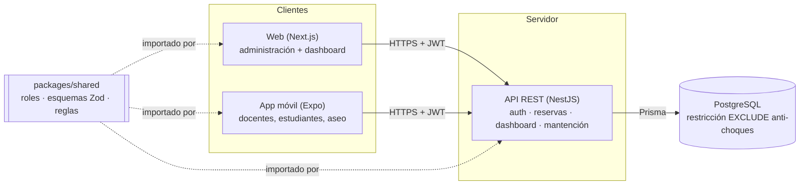

# 3. Arquitectura

## Principios

1. **Una sola fuente de reglas.** Roles, permisos, esquemas de validación y reglas de negocio
   viven en `packages/shared`. La web y la app validan *antes* de enviar (mejor experiencia);
   la API valida *otra vez* con el mismo esquema (seguridad). Nunca se reescribe una regla.
2. **Validación en tres capas.**
   | Capa | Qué valida | Ejemplo |
   |---|---|---|
   | Cliente (web/móvil) | Formato y reglas simples, con mensajes inmediatos | fin > inicio, horario 08:00–23:00 |
   | API | Lo mismo + permisos + estado | rol puede aprobar, transición PENDIENTE→APROBADA |
   | Base de datos | Invariantes que **nunca** se pueden romper | `EXCLUDE` anti-choques, bitácora inmutable |
3. **Un módulo de la API por paquete de la EDT**, para que el avance se mida igual que en la EDT.
4. **API REST + JSON** con prefijo `/api`, autenticación por JWT en la cabecera `Authorization`.

## Endpoints actuales

| Método | Ruta | Permiso | Requisito |
|---|---|---|---|
| POST | `/api/auth/login` | público | R19 |
| GET | `/api/sedes`, `/api/salas` | sesión | R3 |
| POST | `/api/salas` | `recurso:gestionar` | — |
| GET | `/api/reservas/ocupacion?desde&hasta&salaId` | sesión | R3 |
| POST | `/api/reservas` | `reserva:solicitar` | R1, R2, R4, R11 |
| POST | `/api/reservas/sugerencia` | `reserva:solicitar` | R10 |
| GET | `/api/reservas/pendientes` | `reserva:aprobar` | R4 |
| POST | `/api/reservas/:id/aprobar` · `/rechazar` | `reserva:aprobar` | R4, R6 |
| POST | `/api/reservas/:id/cancelar` | propia o `reserva:cancelar_cualquiera` | R5 |
| GET | `/api/reservas/:id/historial` | sesión | R7 |
| GET | `/api/dashboard/ocupacion?desde&hasta&sedeId` | `dashboard:ver` | R12, R13, R14 |
| GET | `/api/dashboard/indicadores?desde&hasta` | `dashboard:ver` | Beneficios B3, B6 |
| GET/PATCH | `/api/notificaciones/mias`, `/:id/leida` | sesión | R6 |
| POST | `/api/mantencion/danios`, `/inventario` | `danio:reportar`, `inventario:registrar` | R17 |
| GET/PATCH | `/api/mantencion/danios` | `danio:gestionar` | R17 |

## Zona horaria

Todas las fechas se guardan en UTC (`timestamptz`). Las reglas de horario se evalúan en
`America/Santiago` (`TZ` en la API). Los clientes envían fechas ISO 8601.

Decisiones registradas en [adr/](adr/).
