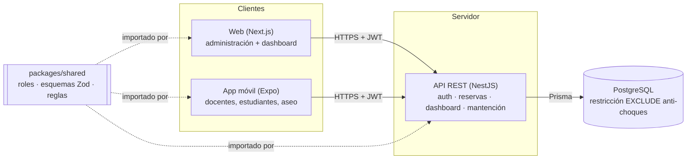

# 3. Arquitectura

## Principios

1. **Una sola fuente de reglas.** Roles, permisos, esquemas de validación y reglas de negocio
   viven en `packages/shared`. La web y la app validan *antes* de enviar (mejor experiencia);
   la API valida *otra vez* con el mismo esquema (seguridad). Nunca se reescribe una regla.
2. **Validación en tres capas.**
   | Capa | Qué valida | Ejemplo |
   |---|---|---|
   | Cliente (web/móvil) | Formato y reglas simples, con mensajes inmediatos | fin > inicio, horario 08:00–23:00 |
   | API | Lo mismo + permisos + estado | rol puede aprobar, transición PENDIENTE→APROBADA |
   | Base de datos | Invariantes que **nunca** se pueden romper | `EXCLUDE` anti-choques, bitácora inmutable |
3. **Un módulo de la API por paquete de la EDT 1.4** (`usuarios/` = 1.4.1 … `proyeccion/` = 1.4.8), para que el avance se mida igual que en la EDT. Ver la tabla en [02-roadmap.md](02-roadmap.md#estructura-del-desarrollo-edt-14--código).
4. **API REST + JSON** con prefijo `/api`, autenticación por JWT en la cabecera `Authorization`.

## Endpoints actuales (modelo v1)

| Método | Ruta | Permiso | Requisito |
|---|---|---|---|
| POST | `/api/auth/login` | público | R19; devuelve roles con ámbito y permisos calculados por la base |
| GET | `/api/auth/yo` | sesión | — |
| GET/POST | `/api/usuarios` | `usuario:gestionar` | E4: persona + cuenta + roles en una transacción |
| GET | `/api/sedes`, `/api/espacios?sedeId&tipo`, `/api/catalogos` | sesión | R3 |
| POST | `/api/espacios` | `recurso:gestionar` | E5 |
| POST | `/api/importaciones` (multipart: `archivo`, `periodo`) | `planificacion:importar` | R9, E5 |
| GET | `/api/importaciones` | `planificacion:importar` | R9 |
| POST | `/api/reservas` (única o semanal con `repetirHasta`) | `reserva:solicitar` | R1, R2, R4, R11, D11–D13 |
| GET | `/api/reservas/ocupacion?desde&hasta&espacioId`, `/api/reservas/mias` | sesión | R3 |
| POST | `/api/reservas/:id/cancelar` (`motivo`, obligatorio si la reserva es de otra persona) | propia o `reserva:cancelar_cualquiera` | R5, R7 (queda en `reservas.cancelacion`) |
| POST | `/api/reservas/check-in` (`token` del QR) | sesión | R18, D15 |
| GET | `/api/reservas/:id/historial` | sesión | R7 (vista de trazabilidad + bitácora) |
| GET | `/api/solicitudes/pendientes` | `reserva:aprobar` | R4: solo las que `reservas.puede_aprobar` permite |
| POST | `/api/solicitudes/:id/aprobar`, `/rechazar` (motivo obligatorio) | `reserva:aprobar` | R4, R6, D14 |
| POST | `/api/sugerencia` | `reserva:solicitar` | R10 |
| GET | `/api/dashboard/ocupacion`, `/api/dashboard/indicadores`, `/api/dashboard/reservas` | `dashboard:ver` | R12, R13, R7, B3, B6 |
| GET | `/api/dashboard/reporte.xlsx?desde&hasta&sedeId` | `reporte:generar` | R13: Excel con resumen, ocupación por espacio, detalle de reservas y uso por jornada |
| GET | `/api/proyeccion` | `dashboard:ver` | R14 |
| GET/PATCH | `/api/notificaciones/mias`, `/:id/leida` | sesión | R6 |
| POST | `/api/mantencion/inspecciones` | `inventario:registrar` | R17, D17 |
| POST/GET | `/api/mantencion/danios` | `danio:reportar` / `danio:gestionar` | R17 |
| POST/PATCH | `/api/mantencion/ordenes` (con bloqueo opcional de la sala) | `danio:gestionar` | R15, D16 |

**Tareas programadas** (`tareas/`, cada minuto, con candado de PostgreSQL para que corra en una sola
instancia): vencer las solicitudes pendientes (D12) y liberar las reservas sin check-in (R18).

**Auditoría:** toda escritura pasa por `PrismaService.conActor()`, que identifica al usuario en la
transacción para que `auditoria.evento` registre quién hizo cada cambio.

## Zona horaria

Todas las fechas se guardan en UTC (`timestamptz`). Las reglas de horario se evalúan en
`America/Santiago` (`TZ` en la API). Los clientes envían fechas ISO 8601.

Decisiones registradas en [adr/](adr/).
