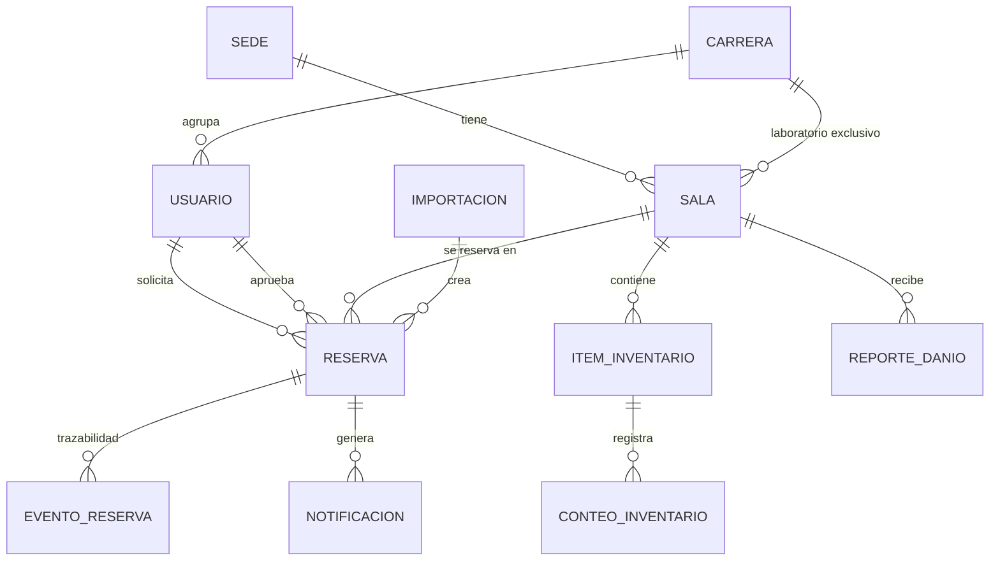
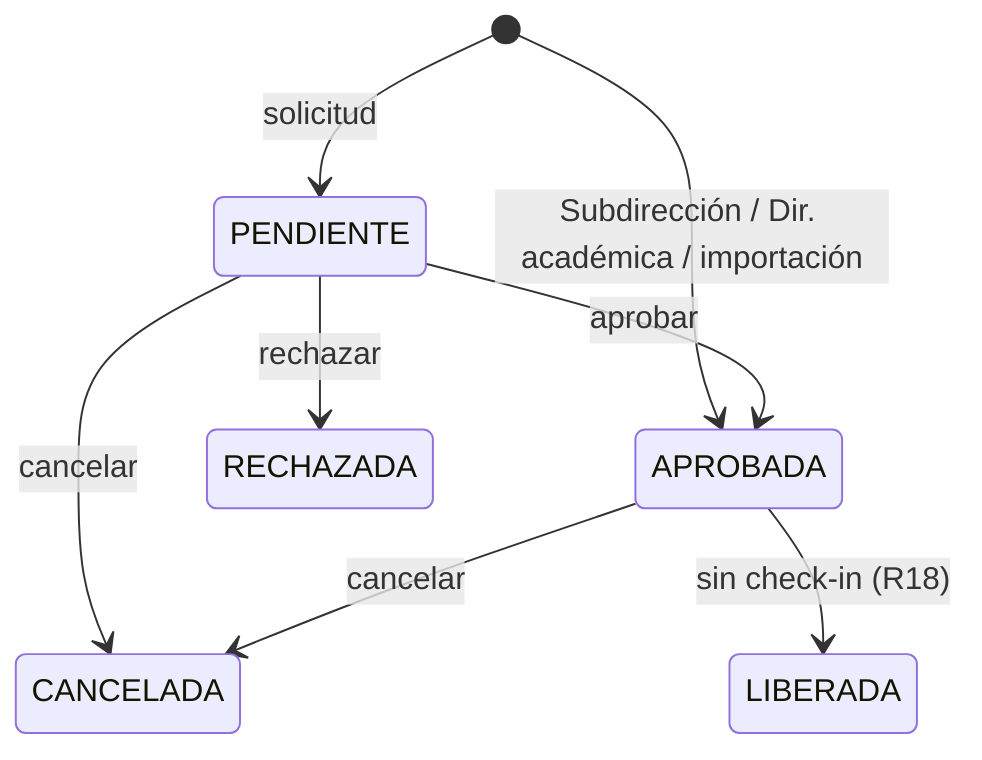

# 4. Modelo de datos (E2)

Fuente de verdad: [`apps/api/prisma/schema.prisma`](../apps/api/prisma/schema.prisma).

## Reglas garantizadas por la base de datos

| Regla | Implementación | Requisito |
|---|---|---|
| Una sala no puede tener dos reservas **APROBADAS** que se solapen | `EXCLUDE USING gist (sala_id WITH =, tstzrange(inicio, fin, '[)') WITH &&) WHERE estado = 'APROBADA'` | R1 |
| El término es posterior al inicio | `CHECK (fin > inicio)` | R19 |
| La bitácora de reservas no se edita ni se borra | Trigger `eventos_reserva_inmutables` | R7 |
| Código de sala único por sede; RUT y correo únicos | Índices únicos | — |

Las reservas de **planificación** (Excel) y de **mantención** son filas de `reservas` con otro `origen`,
por lo que también participan en el anti-choques: el aseo nunca queda programado durante una clase (R15).

## Estados de una reserva

## Pendiente de validar con el cliente (semana 3–4)

- Campos exactos de cada reserva que define el encargado de informática (R19).
- Columnas del Excel de planificación (`filaPlanificacionSchema`).
- Regla de liberación: ¿cuántos minutos sin check-in liberan la sala?
- ¿Las solicitudes **pendientes** deben bloquear el horario o solo las aprobadas? (hoy: solo aprobadas).
