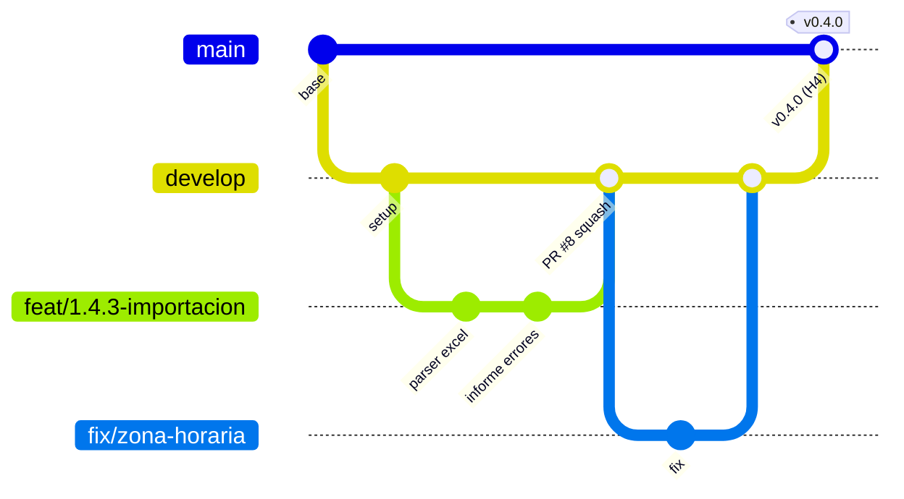

# 5. Flujo Git y GitHub

## Ramas



| Rama | Para qué | Se despliega en |
|---|---|---|
| `main` | Versión estable entregada al cliente. Solo recibe merges desde `develop` en cada hito. | Producción |
| `develop` | Integración diaria del equipo. | Staging |
| `feat/<edt>-<tema>` | Una historia de usuario. Vive ≤ 2 días. | — |
| `fix/<tema>` | Corrección de un bug. | — |
| `hotfix/<tema>` | Corrección urgente en producción (desde `main`, se integra a ambas). | Producción |

## Commits — Conventional Commits

```
feat(reservas): permitir comentario al rechazar (#14)
fix(dashboard): corregir horas fuera del rango consultado (#21)
test(shared): 200 casos anti-choques
docs: actualizar trazabilidad R10
chore(ci): cache de pnpm
```

Ámbitos sugeridos: `api`, `web`, `mobile`, `shared`, `db`, `reservas`, `dashboard`, `mantencion`, `ci`, `docs`.

## Pull Requests

- Siempre hacia `develop` (excepto releases y hotfix).
- Usar la plantilla; enlazar el issue (`Closes #N`).
- Revisión obligatoria de 1 integrante (ver dueños por carpeta en `.github/CODEOWNERS`).
- **Squash and merge** para un historial limpio.
- PR pequeños: idealmente < 400 líneas cambiadas.

## Releases por hito

Al cerrar cada hito, GP abre un PR `develop → main`, se etiqueta y se publica un *Release* en GitHub
con las notas (sirve de evidencia para el acta de aceptación):

| Hito | Tag |
|---|---|
| H4 Núcleo web | `v0.4.0` |
| H5 Web + móvil completas | `v0.5.0` |
| H6 UAT aprobada | `v0.9.0` |
| H7 Puesta en marcha | `v1.0.0` |

## Primer push

Desde la carpeta del proyecto (con `gh` autenticado):

```bash
gh repo create JBG-Tech/reservaitn --private --source=. --remote=origin
```

```bash
git push -u origin main
```

```bash
git checkout -b develop && git push -u origin develop
```

```bash
bash scripts/github-setup.sh JBG-Tech/reservaitn
```

## Protección de ramas (Settings → Branches → Add rule)

Para `main` y `develop`:
- Require a pull request before merging (1 aprobación).
- Require status checks to pass: `CI / verificar`.
- Do not allow force pushes.

## Secretos (Settings → Secrets and variables → Actions)

`DATABASE_URL` (staging/producción), `JWT_SECRET`, `EXPO_TOKEN`. **Nunca** se suben archivos `.env`.
