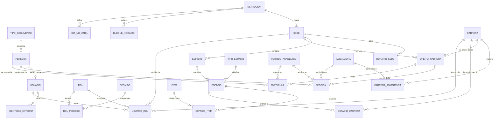
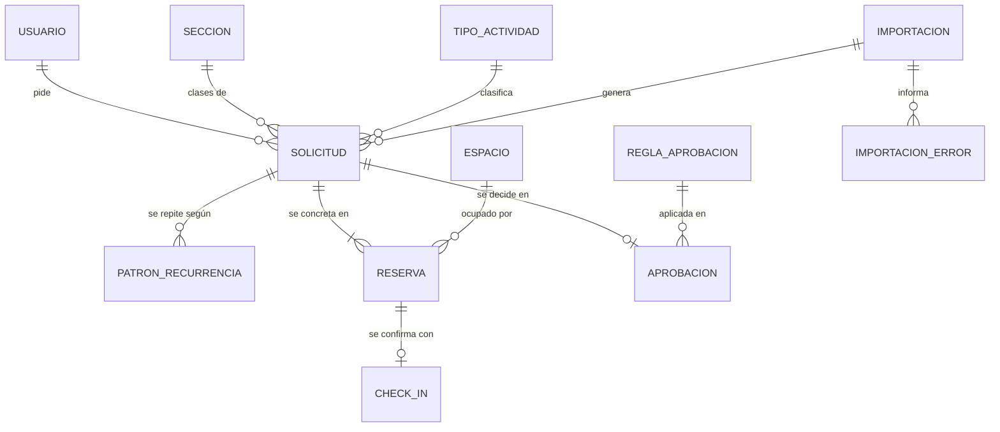
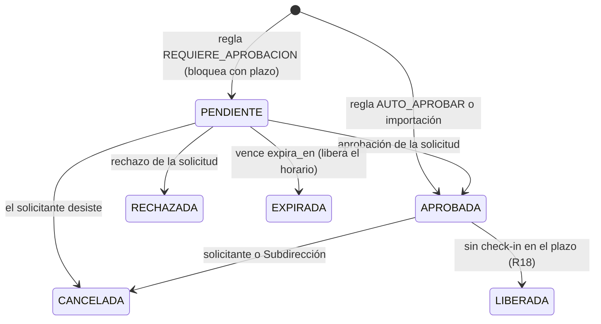
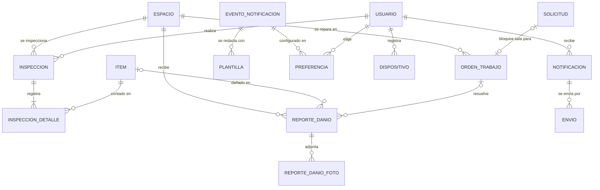

# Decisiones del modelo de datos

Ver también: [normalizacion.md](normalizacion.md) (verificación formal, FNBC).

Registro de las decisiones tomadas por el equipo en las rondas de diseño.
Cada decisión indica su motivo y su efecto en el modelo.

## Ronda 1: decisiones transversales (29/10/2026)

| ID | Tema | Decisión | Efecto en el modelo |
|---|---|---|---|
| D1 | Instituciones | Una empresa con 2 sedes que operan igual | Tabla raíz `institucion` (una fila) con la configuración global; `sede` solo guarda lo que difiere (dirección, edificios, horario). Catálogos y reglas son comunes. |
| D2 | Roles | Varios roles por usuario, con ámbito; roles y permisos en tablas | `rol`, `permiso`, `rol_permiso`, `usuario_rol(ambito: institución, sede o carrera)` |
| D3 | Tiempo | Bloques institucionales + horario libre | Catálogo `bloque_horario`; cada reserva guarda `inicio`/`fin` reales (los bloques son una ayuda, no una restricción) |
| D4 | Infraestructura | Jerarquía física + tipos configurables | `sede → edificio → piso → espacio`; `tipo_espacio` y `equipamiento` como catálogos; equipamiento = característica del espacio (no reservable) |

## Diagnóstico del modelo inicial

1. `Sala.equipamiento` como lista: viola 1FN.
2. Una sola carrera exclusiva por sala: rígido.
3. Un solo rol y una sola carrera por usuario: dependencia mal ubicada.
4. Asignatura como texto libre en `motivo`: viola 3FN.
5. Clases recurrentes sin entidad que las agrupe.
6. Aprobador duplicado en `Reserva` y `EventoReserva`: redundancia.
7. `EventoReserva.accion` como texto libre.
8. Conteo de inventario sin cabecera.
9. Faltan calendario, feriados, check-in y órdenes de trabajo.
10. Falta auditoría estándar y borrado lógico.

## Organización en esquemas de PostgreSQL

| Esquema | Contenido |
|---|---|
| `seguridad` | tipo_documento, persona, usuario, identidad_externa, rol, permiso, rol_permiso, usuario_rol |
| `institucion` | institucion, parametro, sede, horario_sede, edificio, espacio, tipo_espacio, item, espacio_item, espacio_carrera, bloque_horario, dia_no_habil |
| `academico` | periodo_academico, carrera, oferta_carrera, asignatura, carrera_asignatura, seccion, matricula |
| `reservas` | tipo_actividad, solicitud, patron_recurrencia, reserva, regla_aprobacion, aprobacion, check_in, importacion, importacion_error |
| `mantencion` | inspeccion, inspeccion_detalle, reporte_danio, reporte_danio_foto, orden_trabajo |
| `comunicacion` | evento_notificacion, plantilla, preferencia, dispositivo, notificacion, envio |
| `auditoria` | evento (bitácora inmutable) |

## Ronda 2: identidad y estructura académica (29/10/2026)

| ID | Tema | Decisión | Efecto en el modelo |
|---|---|---|---|
| D5 | Inicio de sesión | Cuenta institucional (SSO) + contraseña local | `usuario.password_hash` opcional; `identidad_externa(proveedor, sujeto)` |
| D6 | Identificación | Tipo + número de documento | `tipo_documento` (catálogo) + `numero_documento`, únicos en conjunto; RUT validado con dígito verificador |
| D7 | Estudiante–carrera | Matrícula por período | `matricula(persona, carrera, sede, periodo, estado)` |
| D8 | Detalle académico | Carrera → asignatura → sección | `periodo_academico`, `carrera`, `asignatura`, `seccion(docente, cupo, inscritos)` |
| D9 | Persona y cuenta | Se separan `persona` (ser humano) y `usuario` (cuenta) | Un docente del Excel existe como persona sin cuenta; evita anomalías de inserción |

---

# Convenciones

| Tema | Regla |
|---|---|
| Nombres | `snake_case`, en español, tablas en singular (`espacio`, no `espacios`) |
| Claves primarias | `id uuid` generado por la base (`gen_random_uuid()`); las tablas de relación N:M usan clave compuesta |
| Claves naturales | Todo catálogo y entidad maestra tiene un `codigo` único (ej. sala `A-101`, período `2027-1`) para importar y cruzar datos |
| Fechas | `timestamptz` (UTC); fechas sin hora en `date`, horas del día en `time` |
| Auditoría | Las tablas llevan `creado_en` (y `actualizado_en` si se editan). Quién hizo cada cambio queda en `auditoria.evento`, no en cada tabla (N2) |
| Borrado | Lógico (`activo = false`) en tablas maestras; las transacciones nunca se borran, cambian de estado |
| Enum o catálogo | **Enum** si el código depende del valor (estados de una reserva); **tabla catálogo** si el cliente puede agregar valores (tipos de espacio, equipamiento) |
| Parámetros de negocio | Tabla `parametro` (ej. minutos para liberar una reserva), no constantes en el código |

# Modelo lógico: seguridad, institución y académico

## Esquema `seguridad`

| Tabla | Columnas principales | Claves y restricciones |
|---|---|---|
| `tipo_documento` | codigo (`RUT`, `PAS`, `DNI`), nombre, valida_digito | PK codigo |
| `persona` | tipo_documento, numero_documento, nombres, apellido_paterno, apellido_materno, email, telefono | UNIQUE(tipo_documento, numero_documento); UNIQUE(email) |
| `usuario` | persona_id, password_hash (nulo si usa solo SSO), estado (`ACTIVO`, `BLOQUEADO`), ultimo_acceso | UNIQUE(persona_id): una cuenta por persona |
| `identidad_externa` | usuario_id, proveedor (`GOOGLE`, `MICROSOFT`), sujeto | UNIQUE(proveedor, sujeto) |
| `rol` | codigo, nombre, es_sistema | UNIQUE(codigo) |
| `permiso` | codigo (`reserva:aprobar`), modulo, descripcion | UNIQUE(codigo) |
| `rol_permiso` | rol_id, permiso_id | PK compuesta |
| `usuario_rol` | usuario_id, rol_id, sede_id, carrera_id, vigente_desde, vigente_hasta | UNIQUE NULLS NOT DISTINCT(usuario, rol, sede, carrera). Ámbito por combinación: ninguno = institución; solo sede = sede; solo carrera = carrera en ambas sedes; carrera + sede = esa oferta |

## Esquema `institucion`

| Tabla | Columnas principales | Claves y restricciones |
|---|---|---|
| `institucion` | nombre, rut, zona_horaria | Una fila (D1) |
| `parametro` | clave, valor, tipo, descripcion | PK clave |
| `sede` | institucion_id, codigo, nombre, direccion, comuna | UNIQUE(codigo) |
| `horario_sede` | sede_id, dia_semana (1–7), apertura, cierre | PK(sede_id, dia_semana); CHECK cierre > apertura |
| `edificio` | sede_id, codigo, nombre | UNIQUE(sede_id, codigo) |
| `tipo_espacio` | codigo (`SALA`, `LAB`, `AUDITORIO`, `TALLER`…), nombre, requiere_aprobacion, reservable_por_estudiantes | UNIQUE(codigo) |
| `espacio` | edificio_id, tipo_espacio_id, codigo, nombre, **piso**, capacidad, accesible, reservable, token_qr | UNIQUE(edificio_id, codigo); UNIQUE(token_qr); CHECK capacidad > 0 |
| `item` | codigo, nombre, categoria (`MOBILIARIO`, `TECNOLOGIA`, `CLINICO`…), filtrable | UNIQUE(codigo). Un solo catálogo para equipamiento e inventario (D19) |
| `espacio_item` | espacio_id, item_id, cantidad_esperada | PK compuesta; CHECK cantidad_esperada > 0 |
| `espacio_carrera` | espacio_id, carrera_id, prioridad (`EXCLUSIVO`, `PREFERENTE`) | PK compuesta |
| `bloque_horario` | codigo, jornada, hora_inicio, hora_fin, orden | UNIQUE(codigo); EXCLUDE: bloques sin solaparse |
| `dia_no_habil` | fecha, sede_id (nulo = ambas sedes), tipo (`FERIADO`, `RECESO`, `EVENTO`), motivo | UNIQUE NULLS NOT DISTINCT(fecha, sede_id) |

**Piso** es una columna de `espacio` y no una tabla: no tiene atributos propios. Crear una entidad
sin atributos solo agrega un JOIN.

## Esquema `academico`

| Tabla | Columnas principales | Claves y restricciones |
|---|---|---|
| `periodo_academico` | codigo (`2027-1`), nombre, fecha_inicio, fecha_fin, estado | UNIQUE(codigo); EXCLUDE: períodos sin solaparse |
| `carrera` | codigo, nombre, activo | UNIQUE(codigo) |
| `asignatura` | codigo, nombre, horas_semanales, tipo_espacio_requerido_id | UNIQUE(codigo) |
| `carrera_asignatura` | carrera_id, asignatura_id, nivel | PK compuesta (una asignatura puede ser común a varias carreras, ej. Inglés) |
| `oferta_carrera` | carrera_id, sede_id, jornada (`DIURNA`, `VESPERTINA`), activo | UNIQUE(carrera, sede, jornada) |
| `seccion` | periodo_id, asignatura_id, oferta_carrera_id, codigo, docente_persona_id, cupo, inscritos | UNIQUE(periodo, asignatura, oferta, codigo). La sede se obtiene de la oferta (no se repite) |
| `matricula` | persona_id, oferta_carrera_id, periodo_id, estado (`VIGENTE`, `SUSPENDIDA`, `RETIRADA`, `EGRESADA`) | UNIQUE(persona, oferta, periodo) |

`seccion.inscritos` se guarda y no se calcula, porque el sistema no registra la inscripción de cada
estudiante en cada sección (está fuera del alcance); el dato viene del Excel de planificación.

## Ronda 3: núcleo de reservas (29/10/2026)

| ID | Tema | Decisión | Efecto en el modelo |
|---|---|---|---|
| D10 | Oferta de carreras | Una carrera se ofrece por sede y jornada | `oferta_carrera(carrera, sede, jornada)`; matrícula y sección apuntan a la oferta |
| D11 | Aprobación | Reglas configurables, un nivel | `regla_aprobacion` (tipo de espacio × rol solicitante × tipo de actividad → acción y rol aprobador) |
| D12 | Bloqueo | La primera solicitud bloquea el horario con un plazo | Restricción anti-choques sobre `PENDIENTE` + `APROBADA`; `reserva.expira_en`; vencida → `EXPIRADA` |
| D13 | Recurrencia | Series con regla, también para usuarios | `solicitud` + `patron_recurrencia`; cada fecha es una `reserva` propia |
| D14 | Solicitud y reserva | Se separa *qué se pide* (solicitud) de *cada fecha concreta* (reserva) | La aprobación es sobre la solicitud (una serie se aprueba de una vez); el anti-choques y la cancelación son por reserva |

# Modelo lógico: reservas

## Esquema `reservas`

| Tabla | Columnas principales | Claves y restricciones |
|---|---|---|
| `tipo_actividad` | codigo (`CLASE`, `EVALUACION`, `ESTUDIO`, `REUNION`, `EVENTO`, `MANTENCION`), nombre | UNIQUE(codigo). Catálogo: alimenta reglas y reportes (B5) |
| `solicitud` | solicitante_usuario_id, tipo_actividad_id, seccion_id (opcional), origen (`SOLICITUD`, `PLANIFICACION`, `MANTENCION`), descripcion, asistentes, fecha_desde, fecha_hasta, importacion_id | CHECK asistentes > 0; CHECK fecha_hasta ≥ fecha_desde. Fechas solo si es recurrente |
| `patron_recurrencia` | solicitud_id, dia_semana (1–7), hora_inicio, hora_fin | PK(solicitud_id, dia_semana, hora_inicio); CHECK hora_fin > hora_inicio. Una fila por día: "lunes 8–10 y miércoles 10–12" son dos filas (1FN, en vez de una lista de días) |
| `reserva` | solicitud_id, espacio_id, inicio, fin, estado, expira_en | **EXCLUDE** (espacio_id =, tstzrange(inicio, fin) &&) WHERE estado IN (`PENDIENTE`, `APROBADA`); CHECK fin > inicio; CHECK expira_en solo si `PENDIENTE` |
| `regla_aprobacion` | tipo_espacio_id, rol_solicitante_id, tipo_actividad_id (nulos = "cualquiera"), accion (`AUTO_APROBAR`, `REQUIERE_APROBACION`, `PROHIBIDO`), rol_aprobador_id, ambito_aprobador (`CARRERA_SOLICITANTE`, `CARRERA_ESPACIO`, `INSTITUCION`), prioridad | Gana la regla de mayor prioridad que coincida; UNIQUE NULLS NOT DISTINCT(tipo_espacio, rol, actividad) |
| `aprobacion` | solicitud_id, regla_aprobacion_id, decision (`APROBADA`, `RECHAZADA`), decidido_por_usuario_id (nulo = automática), decidido_en, comentario | UNIQUE(solicitud_id): un nivel (D11). Sin fila = pendiente; la aprobación automática también inserta fila (N4). El rechazo exige comentario |
| `check_in` | reserva_id, usuario_id, metodo, registrado_en | PK reserva_id (1:1) |
| `importacion` | archivo_nombre, periodo_id, usuario_id, total_filas, creado_en | Las filas correctas se calculan en una vista (N1) |
| `importacion_error` | id, importacion_id, fila, columna (nula = toda la fila), mensaje | UNIQUE NULLS NOT DISTINCT(importacion_id, fila, columna) (N5). Antes era un JSON: ahora se puede consultar |

## Estados de una reserva

"Finalizada" no se guarda: se deduce de `fin < ahora()`. Guardarlo sería un dato derivado que
puede quedar desactualizado.

## Decisiones de normalización del núcleo

1. **Sin redundancia en la trazabilidad (R7).** Quién pidió = `solicitud.solicitante_usuario_id`;
   cuándo = `solicitud.creado_en`; quién aprobó = `aprobacion.decidido_por_usuario_id`. Ya no se
   repite en `reserva` (corrige el problema 6 del diagnóstico).
2. **Plantilla e instancia.** `patron_recurrencia` es la plantilla; cada `reserva` es una instancia
   que puede cambiar de sala u hora por sí sola. Que la instancia repita datos de la plantilla no
   viola 3FN, porque son hechos distintos: lo planificado y lo que efectivamente se reservó.
3. **Vencimiento del bloqueo (D12).** Una restricción de PostgreSQL no puede usar `now()`. Por eso:
   (a) al crear una solicitud, la API primero marca como `EXPIRADA` las pendientes vencidas de ese
   espacio, en la misma transacción, lo que es exacto; (b) un proceso cada minuto expira las demás.
   El plazo es el parámetro `reserva.minutos_bloqueo_pendiente`.
4. **Días no hábiles.** Al generar las fechas de una serie se omiten las de `dia_no_habil`.

## Volumen estimado y escalabilidad

Unas 400 secciones × 2 clases por semana × 18 semanas ≈ **15.000 reservas por semestre**, más las
solicitudes puntuales. Es un volumen bajo para PostgreSQL: no hace falta particionar. Basta con los
índices `reserva(espacio_id, inicio)`, el índice GiST de la restricción anti-choques y un índice
parcial `reserva(expira_en) WHERE estado = 'PENDIENTE'` para el proceso de vencimiento. Si en el
futuro el historial superara los millones de filas, `reserva` se puede particionar por período sin
cambiar el modelo.

## Ronda 4: operación diaria (29/10/2026)

| ID | Tema | Decisión | Efecto en el modelo |
|---|---|---|---|
| D15 | Check-in | QR en la puerta + app; respaldo manual | `espacio.token_qr` (único, se puede regenerar); `check_in.metodo` (`QR`, `MANUAL`) |
| D16 | Daños | Reporte → orden de trabajo | `reporte_danio` (N) → `orden_trabajo` (1); una orden grave bloquea la sala con una solicitud de tipo `MANTENCION` |
| D17 | Inventario | Tipos + cantidad esperada + inspecciones | `inspeccion` → `inspeccion_detalle(contada, esperada)` |
| D18 | Notificaciones | App + correo + push, con preferencias | Bandeja `notificacion` + cola de salida `envio` por canal |
| D19 | Equipamiento e inventario | **Un solo catálogo** `item` + `espacio_item` | Elimina la redundancia de guardar el proyector en dos tablas (equipamiento e inventario) |

# Modelo lógico: mantención, comunicación y auditoría

## Esquema `mantencion`

| Tabla | Columnas principales | Claves y restricciones |
|---|---|---|
| `inspeccion` | espacio_id, usuario_id, realizada_en, observacion | — |
| `inspeccion_detalle` | inspeccion_id, item_id, cantidad_contada, cantidad_esperada | PK(inspeccion_id, item_id); CHECK cantidades ≥ 0 |
| `reporte_danio` | espacio_id, item_id (opcional), reportado_por_usuario_id, descripcion, severidad (`BAJA`, `MEDIA`, `ALTA`), orden_trabajo_id (opcional), creado_en | Sin orden = pendiente de revisión |
| `reporte_danio_foto` | reporte_danio_id, clave_almacenamiento, tipo_mime, tamano_bytes | Las fotos van a un almacenamiento de archivos; la BD guarda solo la referencia |
| `orden_trabajo` | espacio_id, tipo (`CORRECTIVA`, `PREVENTIVA`), prioridad, estado (`ABIERTA`, `ASIGNADA`, `EN_PROCESO`, `RESUELTA`, `CANCELADA`), asignada_a_usuario_id, solicitud_bloqueo_id, solucion, creado_en, resuelta_en | UNIQUE(solicitud_bloqueo_id); CHECK resuelta_en solo si `RESUELTA` |

**Normalización:**
- El **estado** vive solo en `orden_trabajo`. Si el reporte tuviera su propio estado, podría decir
  "resuelto" mientras la orden sigue abierta.
- Varios reportes del mismo daño se agrupan en una sola orden (N:1), y una mantención preventiva
  es una orden sin reportes.
- `inspeccion_detalle.cantidad_esperada` es una **foto del momento**, no una redundancia: guarda lo
  esperado *al inspeccionar*. Si después cambia `espacio_item`, las diferencias históricas se mantienen.

## Esquema `comunicacion`

| Tabla | Columnas principales | Claves y restricciones |
|---|---|---|
| `evento_notificacion` | codigo (`SOLICITUD_CREADA`, `SOLICITUD_APROBADA`, `SOLICITUD_RECHAZADA`, `RESERVA_CANCELADA`, `RESERVA_LIBERADA`, `DANIO_REPORTADO`, `ORDEN_ASIGNADA`…), descripcion, obligatorio | PK codigo. Los eventos obligatorios (ej. cancelación) no se pueden desactivar |
| `plantilla` | evento_codigo, canal (`APP`, `CORREO`, `PUSH`), asunto, cuerpo | PK(evento_codigo, canal) |
| `preferencia` | usuario_id, evento_codigo, canal, activo | PK(usuario, evento, canal). Solo se guardan las excepciones (por defecto todo activo) |
| `dispositivo` | usuario_id, token_push, plataforma (`ANDROID`, `IOS`), ultimo_uso | UNIQUE(token_push) |
| `notificacion` | usuario_id, evento_codigo, titulo, cuerpo, solicitud_id, reserva_id, orden_trabajo_id, leida_en, creado_en | CHECK: como máximo una referencia. Es la bandeja de la app |
| `envio` | notificacion_id, canal (`CORREO`, `PUSH`), estado (`PENDIENTE`, `ENVIADO`, `FALLIDO`), intentos, ultimo_error, enviado_en | UNIQUE(notificacion_id, canal) |

**Patrón de cola de salida:** la notificación y sus envíos se guardan en la misma transacción que la
acción (por ejemplo, la aprobación) y un proceso aparte los despacha con reintentos. Si el servidor
de correo falla, no se pierde el aviso ni se revierte la aprobación. Además, la tabla `envio` sirve
de evidencia para el beneficio B6.

## Esquema `auditoria`

| Tabla | Columnas principales | Claves y restricciones |
|---|---|---|
| `evento` | id (bigint, autoincremental), esquema, tabla, registro_id, operacion (`INSERT`, `UPDATE`, `DELETE`), actor_usuario_id, datos_antes, datos_despues (jsonb), ocurrido_en | Índice (tabla, registro_id). Solo inserción: un trigger bloquea UPDATE y DELETE |

Un trigger genérico en las tablas de negocio registra cada cambio, y la API indica el actor con
`SET LOCAL app.usuario_id`. Aquí `jsonb` es correcto porque es una foto histórica del registro y no
un dato de negocio que se consulte por sus campos.

# Resumen del modelo

| Esquema | Tablas |
|---|---|
| `seguridad` | 8 |
| `institucion` | 12 |
| `academico` | 7 |
| `reservas` | 9 |
| `mantencion` | 5 |
| `comunicacion` | 6 |
| `auditoria` | 1 |
| **Total** | **48** |

# Pendiente de confirmar con el cliente

1. Bloques horarios reales del ITN (códigos y horas) y si son iguales en ambas sedes.
2. Plazo de bloqueo de una solicitud pendiente (propuesta: 24 horas) y minutos sin check-in para liberar (propuesta: 15).
3. Proveedor de cuentas institucionales (Google Workspace o Microsoft 365).
4. Reglas de aprobación iniciales (tipo de espacio × rol → quién aprueba).
5. Lista inicial de tipos de espacio y de ítems de inventario.
